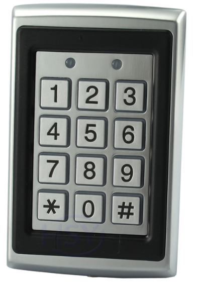

# K7612 keypad and RFID firmware

Replacement firmware for the **STC8C2K32S2** in the K7612 access keypad.
It reads EM4100 RFID tags and decimal PINs, sends credentials over **Wiegand**,
and provides key/tag tones and OPEN-controlled red/green LEDs.



The primary build, `keypad_reader`, starts automatically with **Wiegand-34
output enabled and UART debugging OFF**. Normal operation needs the keypad's
power supply, D0/D1 and common ground connected to a controller, and OPEN if
LED control is required. No UART host or startup command is needed.

The receiving controller handles authorization and unlocking. The firmware
does not store credentials, validate PINs against an access list, operate the
relay. An external ESP32 running ESPHome can receive credentials and control
the indication using the proposed interface below.

## Normal operation

| Action or input | Reader behavior |
| --- | --- |
| Present an EM4100 RF/64 tag | Send its low 32 ID bits in a Wiegand-34 frame and request a tone |
| Hold the same tag in the field | Suppress repeated credential output and tones |
| Remove a tag | Rearm after 1.5 seconds without matching frame or eligible presence-prefix evidence |
| Enter digits, then `#` | Send the decimal PIN value as one Wiegand credential; flash both LEDs for 150 ms |
| Press `*` | Clear the pending PIN |
| Leave PIN entry idle for 10 seconds | Clear the pending PIN |
| OPEN HIGH / released | Red LED on, green off |
| OPEN LOW / grounded | Green LED on, red off |

Each debounced key press requests one tone; holding a key does not repeat it.
Multiple simultaneous keys cancel PIN entry and block new presses until all
keys are released. Tones last approximately 204 ms at 2.5 kHz and share a
non-blocking queue with at least 20 ms between tones.

OPEN changes are debounced for 20 ms during normal reading. The PIN flash
acknowledges local entry only: it does not indicate that the controller accepted
the credential or that Wiegand delivery succeeded. OPEN does not drive the relay.

## Wiegand credentials and configuration

Both RFID and PIN entry use the selected frame format:

| Format | RFID payload | Decimal PIN range | `1234#` payload |
| --- | --- | --- | --- |
| **34-bit (default)** | Low 32 bits of the five-byte ID | 0 to 4,294,967,295 | `000004D2` |
| 26-bit | Low 24 bits of the ID | 0 to 16,777,215 | `0004D2` |

Frames are sent MSB first with leading even and trailing odd parity. The
external D0/D1 wires idle HIGH; a LOW pulse on D0 means zero and on D1 means one.
For example, RFID ID `0102030405` produces payload `02030405` in the default
34-bit format.

PIN digits accumulate locally; individual digits are not sent over Wiegand.
Empty `#` does nothing. More than ten digits or a value outside the selected
range invalidates the entry until submit, clear or timeout. Leading zeros are
not preserved: `001234#` and `1234#` send the same value. PIN and RFID payloads
share a namespace, so the receiver cannot distinguish their source from a frame.

The output queue holds two outstanding frames, including the active frame.
Further submissions are dropped; Wiegand has no acknowledgement or retry.
UART logging does not gate credential output.

The `keypad_reader` flags in [platformio.ini](platformio.ini) select the boot
format and the verified driver polarity:

```ini
build_flags = ${env.build_flags} -DK7612_WIEGAND_ACTIVE=1 -DK7612_WIEGAND_BITS=34
```

Change `K7612_WIEGAND_BITS` to `26` for a persistent 26-bit default and rebuild
and flash. `K7612_WIEGAND_ACTIVE=1` means MCU HIGH pulls the external wire LOW
on the tested board; it does not mean the Wiegand wire pulses HIGH.

While stopped, UART commands `WG26` and `WG34` change the format until reset;
`READ` resumes operation. `WGOFF` disables output. For another board, verify
polarity before enabling its drivers. See the [reader interface](docs/keypad-reader.md)
for `WGPROBE`, timing, queue behavior and the complete command reference.

## ESP32 / ESPHome connection

Use a 3.3 V-powered **SN74LVC2G17 buffer** between the keypad's approximately
5 V D0/D1 wires and ESP32 inputs. Drive OPEN with an external **AO3400A
MOSFET pull-down**: transistor ON gives green; released OPEN gives red. Do not
connect D0, D1 or OPEN directly to ESP32 GPIOs, including an open-drain GPIO.

The [connection guide](docs/esphome-connection.md) includes circuit wiring,
component values, power/reset behavior and an [ESPHome package](examples/esphome-wiegand.yaml)
for a classic ESP32-WROOM-32 DevKit (GPIO25/26 inputs, GPIO27 indication output).
This interface is proposed, not yet bench-qualified. OPEN voltage/current still
need measurement. The firmware now schedules at least 150 ms idle between
Wiegand frames, leaving nominal margin beyond ESPHome's 100 ms receive timeout.
Queued-frame separation passes simulator tests, and Flipper/Rigol captures
confirm approximately 150 ms output gaps. ESP32 testing under Wi-Fi/API load
remains necessary before deployment.

## Hardware

The supported target is the **STC8C2K32S2, LQFP32, at 24 MHz**. These are
physical MCU pins, not numbered connector positions. Verify routing before
using the firmware on another K7612 revision.

| Function | MCU signals | Physical pins |
| --- | --- | --- |
| Crystal XTALO / XTALI | P1.6 / P1.7 | 7 / 8 |
| UART RX / TX | P3.0 / P3.1 | 13 / 14 |
| Matrix rows | P0.0, P0.1, P0.2, P0.3 | 29, 30, 31, 32 |
| Matrix columns | P1.5, P1.4, P1.3 | 6, 5, 4 |
| RFID carrier drive | P3.5 / T0CLKO | 18 |
| RFID comparator inputs | P3.6, P3.7 | 19, 20 |
| Buzzer drive | P3.4 | 17 |
| Green / red LED outputs | P2.6 / P2.7 | 27 / 28 |
| OPEN input (active low) | P2.2 | 23 |
| D0 green / D1 white outputs | P5.4 / P5.5 | 9 / 11 |
| D0 / D1 input sense | P3.3 / P3.2 | 16 / 15 |
| Relay drive (unused by primary firmware) | P2.3 | 24 |

Rows use open-drain outputs and columns use inputs with pull-ups. The carrier
is nominally 125 kHz. The comparator inputs remain unbiased. UART RX has an
internal pull-up so it stays idle HIGH when the programming cable is unplugged.

The board's UART and Wiegand signals are approximately 5 V. Use appropriate
level translation for a 3.3 V adapter, ESP32 or other receiver.

### Programming connection

Use a compatible logic-level USB-to-UART adapter. The supported Arduino Micro
bridge is [ProMicroUartBridge.ino](tools/ProMicroUartBridge/ProMicroUartBridge.ino);
upload it using the Arduino's actual board profile before programming the STC.

| Adapter | Keypad |
| --- | --- |
| TX | MCU RX |
| RX | MCU TX |
| GND | GND |
| Power output | Disconnected; keypad uses its own supply |

The MCU must fully power down before entering its bootloader. Prevent adapter
TX from backfeeding the unpowered target. For a 5 V Arduino Micro, the established
arrangement uses a Schottky diode with cathode toward Arduino TX and anode
toward keypad RX, plus a pull-up from keypad RX to the switched MCU 5 V supply.
Verify that MCU VCC falls close to zero when target power is removed.

**Programming replaces the installed firmware.** Retaining factory operation
requires a separate backup or an unmodified unit. The
[factory UART interface](docs/using-unflashed-k7612.md) uses a different protocol.

## Build and flash

The development toolchain is Python 3.12, PlatformIO and SDCC. Dependencies and
the PlatformIO platform version are pinned in the repository. From the repository
root in PowerShell:

```powershell
python -m venv .venv
.venv/Scripts/python.exe -m pip install -r requirements-tools.txt
.venv/Scripts/pio.exe run -e keypad_reader
.venv/Scripts/python.exe -m serial.tools.list_ports -v
powershell -NoProfile -ExecutionPolicy Bypass -File tools/Flash-STC.ps1 -Port COM14 -Environment keypad_reader
```

Replace `COM14` with the adapter's current port. Close serial applications,
keep the USB adapter powered, and cycle keypad power when prompted. The script
builds first and stops if compilation fails. It uses `stcgal` with the `stc8d`
protocol, 2400-baud detection, 19200-baud programming and 24 MHz calibration.
Building alone does not program the MCU. Other host platforms have not been
hardware-qualified.

| Environment | Purpose |
| --- | --- |
| `keypad_reader` (default) | Main RFID/PIN Wiegand reader, tones and OPEN LEDs; silent UART startup |
| `rfid_firmware_test` | RFID-only diagnostics; UART debugging enabled by default |
| `matrix_test` | Standalone matrix and direct LED/buzzer diagnostics |
| `uart_smoke`, `pin_watch` | Low-level UART and GPIO diagnostics |

## Optional UART diagnostics

The combined image emits no startup banner, probe byte, events or periodic
reports by default. Silence on a connected terminal is normal. To enable
logging at **9600 baud, 8N1**, without flow control:

1. Send `!` to stop reading, then wait 500 ms. With debugging OFF there is no
   stop acknowledgement.
2. Send `DEBUG ON` followed by Enter. Expect `OK DEBUG ON`.
3. Send `?` to inspect configuration, or `WG26` / `WG34` to select a format.
4. Send `READ` followed by Enter to resume reading with diagnostic output.

Example output with debugging enabled:

```text
KEY DOWN 5
KEY UP 5
Frame hex: FF8060280C048142
Data: 0102030405
BEEP DONE
TAG ABSENT REARMED
```

Periodic `READ` lines report acquisition, UART and Wiegand queue counters.
While reading, only `!` is accepted; other received characters are discarded.
Stopping turns off the carrier and tone and clears pending PINs and Wiegand
frames. It can truncate a frame already being transmitted.

To resume silently, send `!`, wait for `OK STOP`, send `DEBUG OFF` and wait
for `OK DEBUG OFF`, then send `READ`. Every reset restores debugging OFF and
the build's Wiegand format. UART debugging is not required for tones or LEDs.

## Validation and limits

Run the hardware-independent regression suite after installing the toolchain:

```powershell
.venv/Scripts/python.exe tools/test_reader.py
```

The suite compiles actual C code and runs it in the 8051 simulator. It covers
RFID framing/parity, sampling and timer wrap, keypad debounce and cancellation,
PIN limits, Wiegand encoding and pulse scheduling, OPEN LEDs, tone queues,
presence suppression, silent-mode controls and interrupt storage isolation.
Fixtures are generated by the tests; no connected hardware or saved captures
are needed. Tests use PlatformIO's SDCC and `s51`, or tools selected through
`SDCC_BIN` / `PATH`.

On **29 October 2026**, the final 14,635-byte combined image was flashed and
cold-boot tested. UART received zero bytes after power-on over approximately
138 seconds without any UART command. Flipper emulation of `0102030405`
produced two Rigol-captured Wiegand-34 frames with payload `02030405` and valid
parity, including reacquisition after removal. No repeat frame was detected
during the held-tag observation; measured pulses were approximately 97 to
101 microseconds. See the [reader interface](docs/keypad-reader.md) for the
bench record, firmware hash and test limits.

EM4100 support is RF/64 Manchester only. Invalid frames are rejected without
bit repair. Presence-prefix matching can maintain suppression through short
frame dropouts, but it is not credential authentication. Reception range,
other board revisions and long-term reliability remain unqualified. Simulator
tests cannot establish analog performance or hardware timing margins.

The [firmware architecture](docs/firmware-architecture.md) describes resource
ownership, concurrency and memory use. After firmware changes, run the suite
and build both reader environments. Keep generated builds, local captures and
machine-specific equipment settings out of firmware commits.
